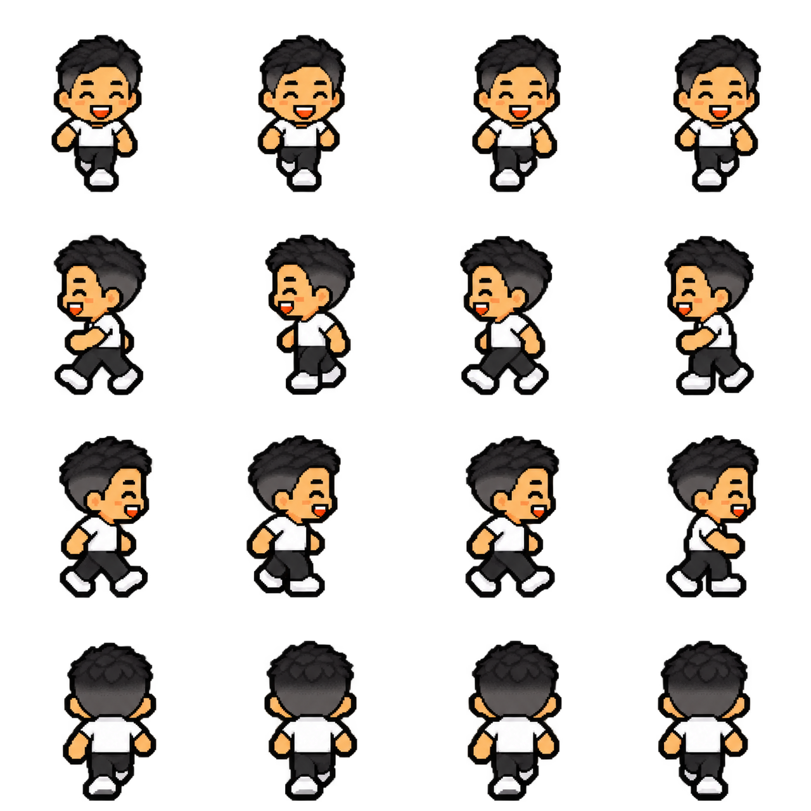
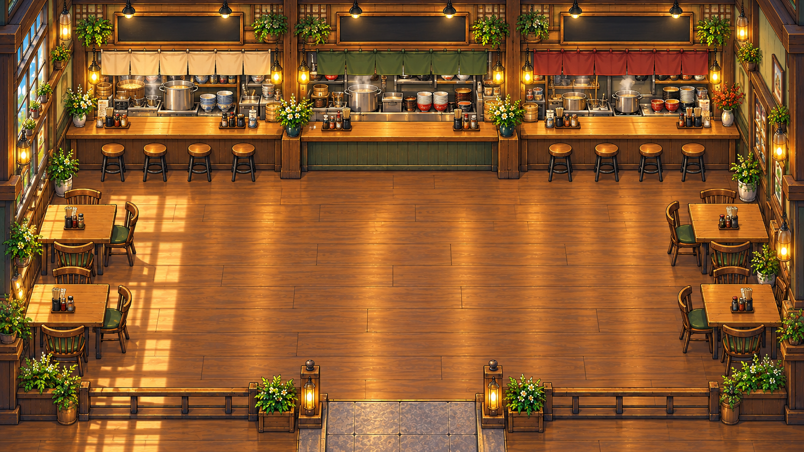
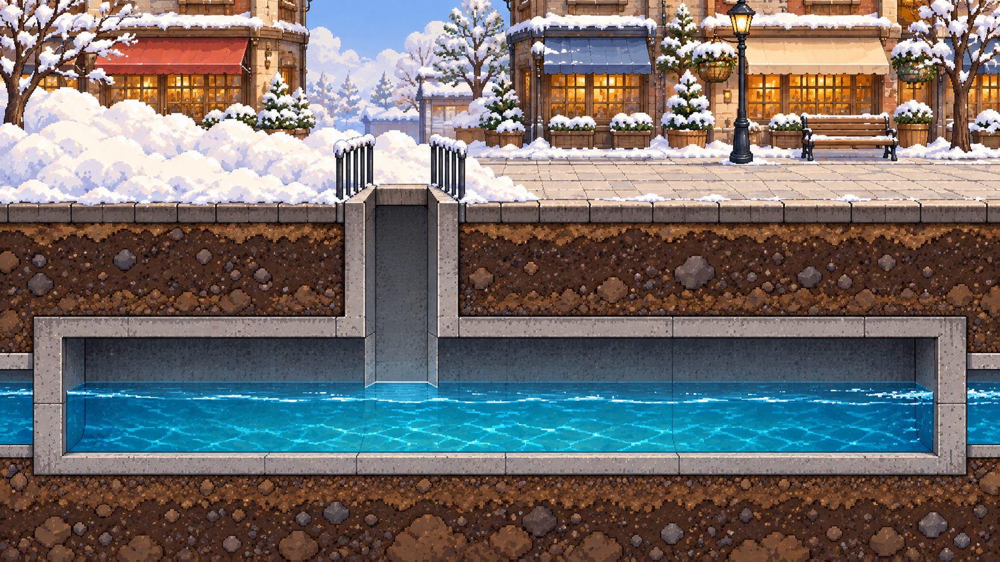
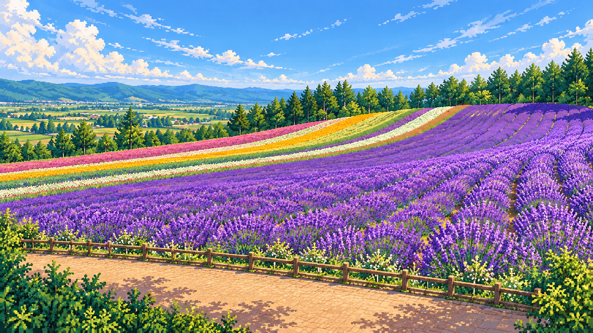
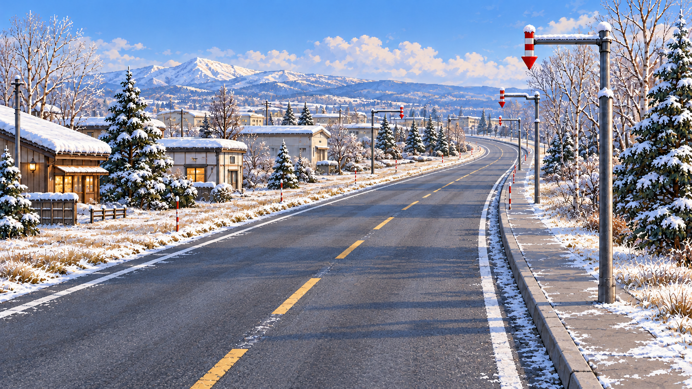
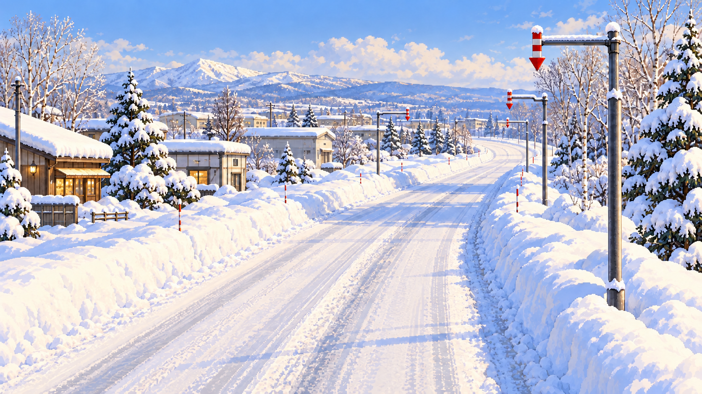
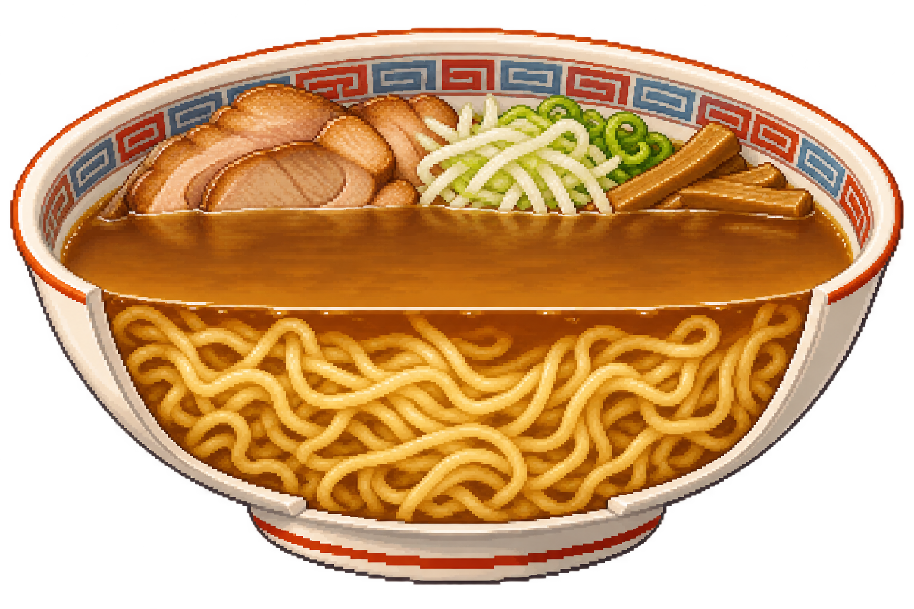
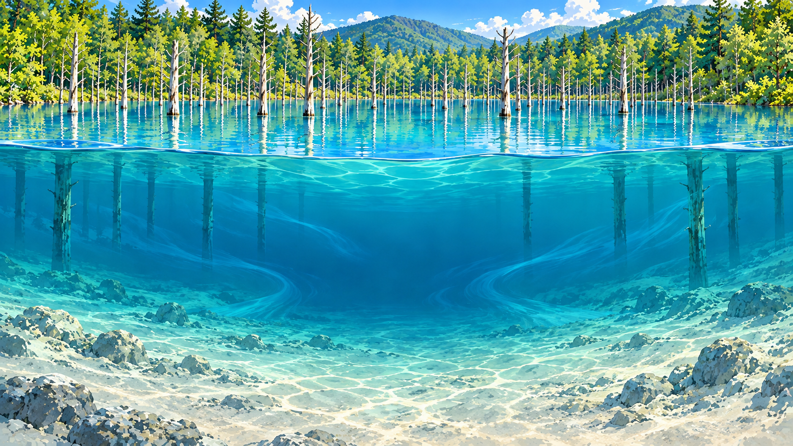

# 예스준 이미지 생성 레퍼런스

Dots·ChatGPT 등에서 **자막 내용 + 이 참고집 + 해당 장면의 실제 자료**를 함께 전달해 예스준 여행영상의 시각 문법을 이어가기 위한 공개 이미지 저장소입니다.

**처음에는 [바로 쓰는 요청문](PROMPTS.md)을 복사하고, 아래에서 장면에 맞는 이미지 2–3장만 함께 사용하세요.** 캐릭터가 등장하면 01번, 실내·구조는 02·03번, 풍경은 04번, 변화 과정은 05·06번, 원리·단면은 07·08번을 선택합니다. 차량 제작 기준은 시각 기준 문서에 정리했습니다.

- [이미지 폴더](design-system/asset-packs/starter-r1/) · [전체 PNG 직접 링크](IMAGE_LINKS.md) · [시각 기준](STYLE_GUIDE.md) · [파일·해시·용도 색인](manifest.json)
- [기존 아사히카와 라이브러리](https://yesjun-design-system.vercel.app/asahikawa/)는 추가 제작 사례입니다. 이 참고집은 특정 도시의 역사·장소·배경을 새 영상에 그대로 복사하도록 지시하지 않습니다.
- 링크만 전달했을 때 이용 중인 채팅이 실제 이미지를 읽지 못하면, PNG 직접 링크를 열어 파일을 첨부하세요. 문서 URL을 읽었다는 사실과 그림을 시각 참조했다는 사실을 구별합니다.

## 이미지 참고표

번호는 참고집 안의 이미지 ID입니다. 실제 영상 화면에 번호를 자동 표시하지 않습니다.

### 01. 예스준 정본 캐릭터

검은 짧은 투블럭, 흰 티셔츠, 검정 바지, 흰 신발, 얼굴과 체형. 4×4 보행 아틀라스이며 장면 전체를 16명으로 그리라는 뜻이 아닙니다.

[PNG 원본 직접 열기](https://raw.githubusercontent.com/imakerjun/yesjun-image-references/main/design-system/asset-packs/starter-r1/01-yesjun-character.png) · 1280 × 1280

### 02. 실내·가게 설명 공간

따뜻한 목재·조명, 가로·세로 통로, 테이블과 주방의 공간 관계. 특정 실제 식당의 복원이 아닌 설명용 공간입니다.

[PNG 원본 직접 열기](https://raw.githubusercontent.com/imakerjun/yesjun-image-references/main/design-system/asset-packs/starter-r1/02-explainer-interior.png) · 1672 × 941

### 03. 인프라·오브젝트 설명

물과 수로, 주변 구조의 관계를 한눈에 읽는 게임식 설명. 정확한 새 장소의 설계나 역사 자료로 복사하지 않습니다.

[PNG 원본 직접 열기](https://raw.githubusercontent.com/imakerjun/yesjun-image-references/main/design-system/asset-packs/starter-r1/03-water-channel.png) · 1672 × 941

### 04. 풍경·자연 원화

작은 픽셀 경계와 풍부한 풍경 세부, 원경·중경·근경의 깊이. 풍경이 중심인 장면의 참고이며 모든 설명 장면에 건물을 채우지 않습니다.

[PNG 원본 직접 열기](https://raw.githubusercontent.com/imakerjun/yesjun-image-references/main/design-system/asset-packs/starter-r1/04-landscape.png) · 1672 × 941

### 05. 과정 설명 · 이전

같은 카메라의 변화 전 장면. 다음 이미지와 나란히 참고해 대상이 왜 필요한지 전후 차이로 설명합니다.

[PNG 원본 직접 열기](https://raw.githubusercontent.com/imakerjun/yesjun-image-references/main/design-system/asset-packs/starter-r1/05-process-before.png) · 1672 × 941

### 06. 과정 설명 · 이후

같은 시점과 장소의 변화 후 장면. 카메라·집·표식 위치를 유지한 채 핵심 상태만 바꿉니다. 실제 특정 도로의 복원은 아닙니다.

[PNG 원본 직접 열기](https://raw.githubusercontent.com/imakerjun/yesjun-image-references/main/design-system/asset-packs/starter-r1/06-process-after.png) · 1672 × 941

### 07. 음식·원리 단면

선명한 재료 덩어리와 단면, 무엇이 안에 있는지 한눈에 읽는 구도. 실제 음식 사진이나 측정된 과학 단면은 아닙니다.

[PNG 원본 직접 열기](https://raw.githubusercontent.com/imakerjun/yesjun-image-references/main/design-system/asset-packs/starter-r1/07-food-cutaway.png) · 1536 × 1024

### 08. 공간·형성 과정 단면

수면 위·아래를 한 화면에 연결하는 공간 설명. 새로운 장소의 지형·형성 원인·시대는 별도 자료에 맞춰 그립니다.

[PNG 원본 직접 열기](https://raw.githubusercontent.com/imakerjun/yesjun-image-references/main/design-system/asset-packs/starter-r1/08-space-cutaway.png) · 1672 × 941

## 공통 기준

- 주인공은 **검은 짧은 투블럭·흰 티셔츠·검정 바지·흰 신발의 예스준**입니다. 정본의 얼굴·체형을 유지하고, 장면마다 다른 사람으로 바꾸지 않습니다.
- 풍경 중심 게임 원화는 **P1–P2**, 신규 시안은 **P2**부터 검토합니다. 신칸센·버스 같은 차량은 **P3**의 분명한 도트 문법을 함께 사용합니다. 모든 자산을 같은 픽셀 굵기로 강제하지 않습니다.
- 정보 UI는 크림 바탕, 짙은 잉크색, 각진 프레임, 단단한 그림자, 절제된 노랑·적색·청록 강조를 씁니다. 지도는 밝은 도트 바다·육지, 크림 지명표, 붉은 경로를 일관되게 사용합니다. 장소 수집 지도에는 의미 있는 장소·동상 아이콘을 우선합니다.
- 자막과 핵심 한글은 편집 단계에서 선명하게 얹습니다. 생성 이미지에 긴 설명문을 굽지 않습니다. 영상 하단에는 한 줄 자막을 놓을 여백을 확보합니다.
- 역사·사실은 실제 자료를 확인하고, 이동·구조·전후 변화를 그림으로 설명합니다. 생성 그림은 실사·현장 증거로 취급하지 않습니다.

이 저장소는 공개 참고용 배포본입니다. 공개 열람과 별도의 포괄적 재배포 라이선스 부여는 구별하며, 자산의 원본·용도·검토 상태는 `manifest.json`에 기록합니다. 기존 생성 이미지에 포함된 간판·세부 배치·색칠·발광 같은 요소 전체가 새로운 장면의 기본값인 것은 아닙니다.
